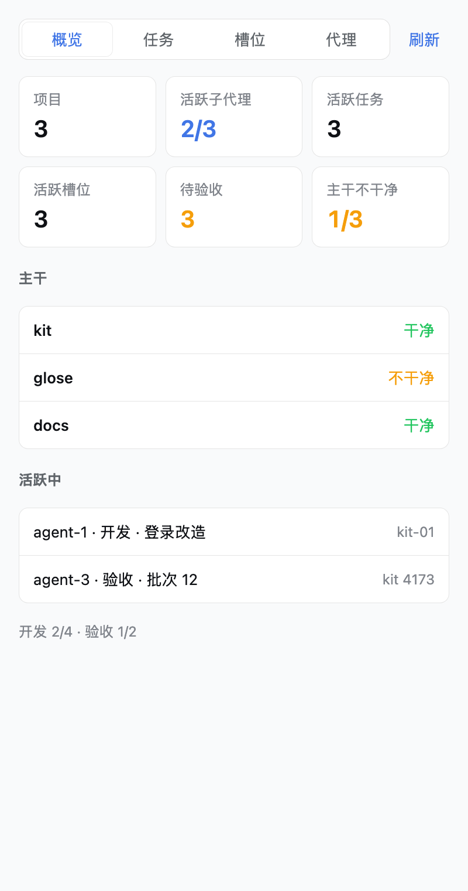
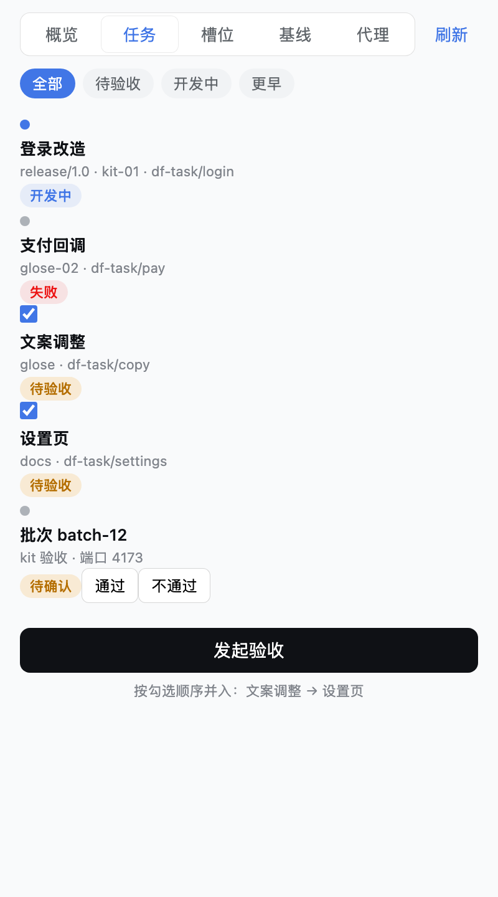
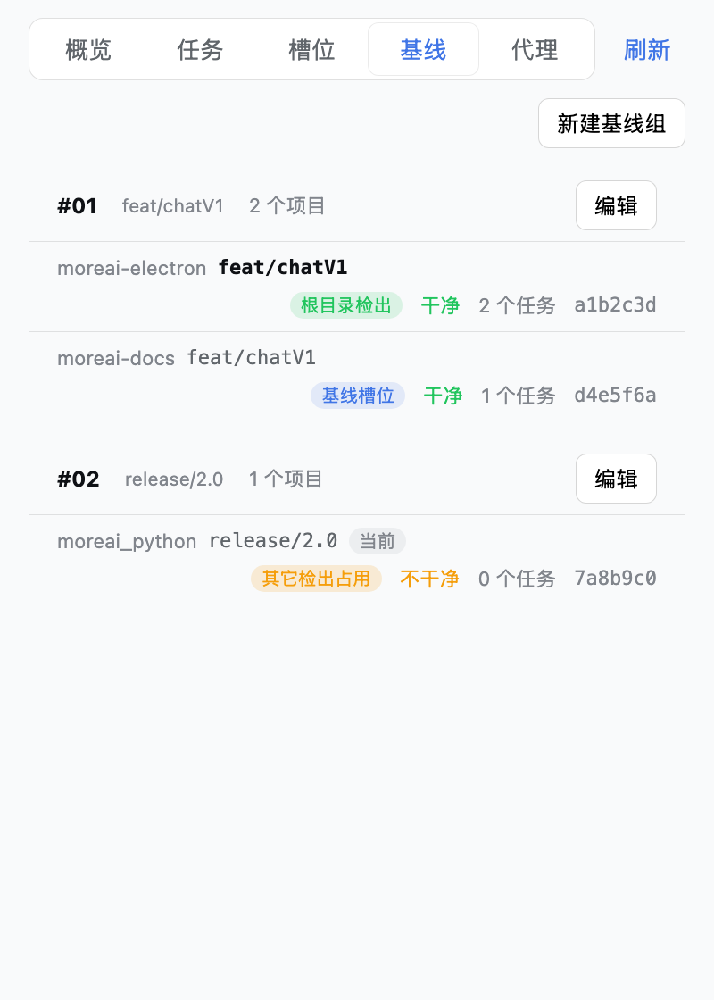

# dsh-dev-flow

多仓库工作区的开发与验收面板。基线按编号分组，一个组里每个项目各有一条基线分支；任务基于哪组就合回组里各自的分支。基线页可以直接新建和编辑基线组。右侧栏五个分页如下。

## 概览

## 任务

任务页可以删除已经结束的开发任务：行内按钮删单条，勾选多条后在底部批量删除。删除会同时删掉该任务的 `df-task/<任务 id>` 分支，并清理槽位、调度、代理和验收批次里的引用。只允许删除 `merged`、`abandoned`、`failed`、`rejected`，以及不在进行中验收批次里的 `pending-acceptance` 任务；仍在开发/等待/调度/待合入、子代理运行中，或仍被其它未删除任务依赖（`dependsOn`）的任务不能删。批量删除会先完整校验，任一任务不合法就整批不动。分支删不掉时面板会提示具体分支，任务记录仍会被清理。

## 槽位

## 基线

## 代理

