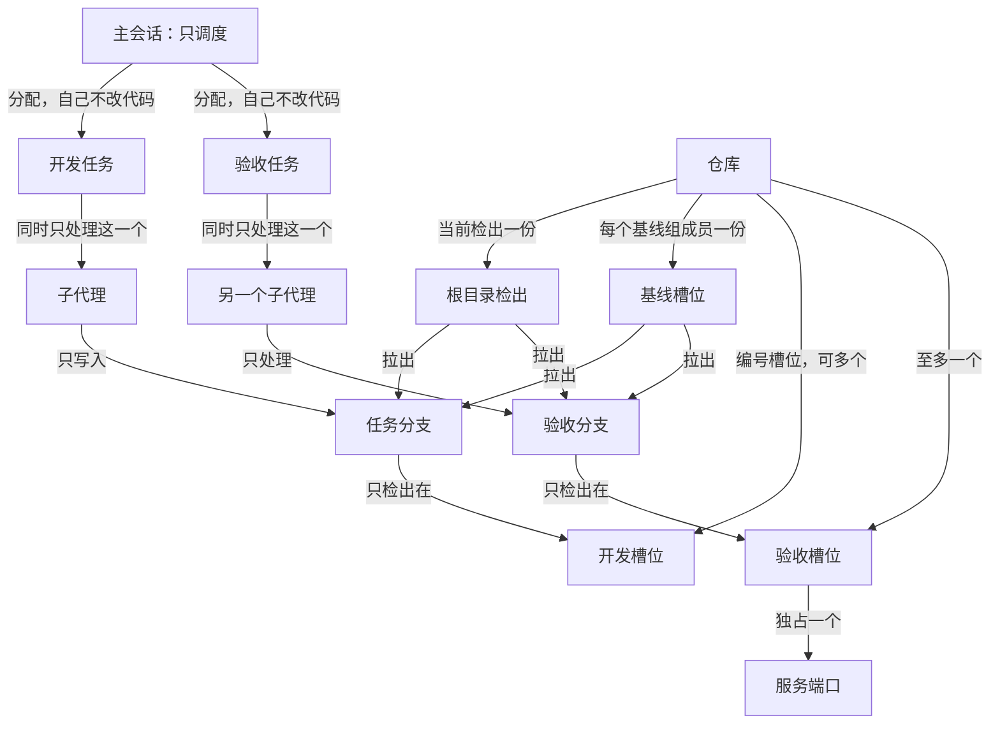
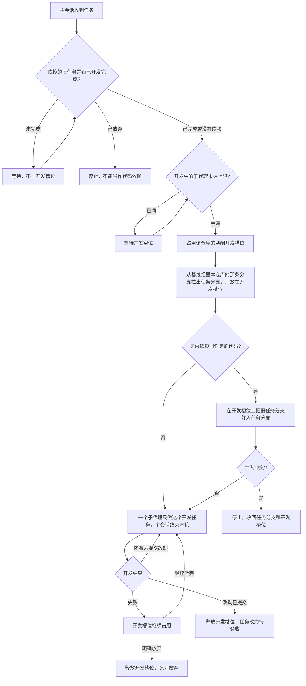
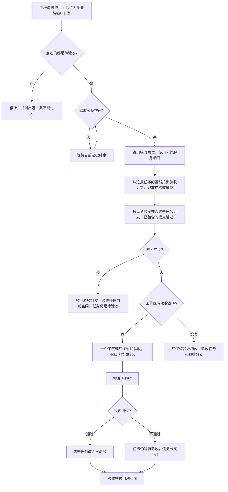

# dsh-dev-flow 需求

多 Git 仓库工作区里的并行开发。一个主会话调度，每条任务在所属基线组的基线上开发，合回同一条基线；根目录检出保持干净。

本文只记录已经定下的需求。worktree-flow 继续负责「单仓库、单基线、多槽位」，本插件不替代它，也不调用它。

## 背景

要同时做多条开发任务时，现在只有两种做法：

- 每个任务开一个代理窗口。任务之间不会互相覆盖，但进度要人工逐个查看和验收。
- 所有任务放在同一个窗口。会话一次只处理一条消息，后面的任务排队。

已有的 worktree-flow 解决的是另一个问题：一个 Git 仓库、一条基线、一组编号槽位。它不适用于「一个工作区下面有多份彼此独立的 Git 仓库」。这种工作区的根目录通常自己不是仓库，也没有统一基线。

## 目标

1. 工作区根上只开一个主会话，就能并行推进多条开发任务。
2. 每条任务独占自己的开发槽位，不改到基线上，也不和别的任务共用同一个槽位。
3. 仓库即使重叠也不排队。后一条任务另开开发槽位继续做。
4. 任务完成后，用过的槽位留下历史，不必到各个窗口里回溯。
5. 基线按编号分组，一组里每个项目各有一条基线分支；任务和调度记录基于哪个基线组；根目录检出和基线槽位保持干净。

## 非目标

- 不把多份仓库收成一个单仓库；基线组编号只用于基线，不与开发/验收槽位编号共用。
- 不复制整棵工作区。
- 不自动 stash、不自动合并、不自动推远程，也不自动删除任务分支。任务完成会自动释放槽位编号，但完成不是合入。
- 开发完成不逐个验收，只把任务改为待验收并空出开发槽位。人工验收在验收槽位上集中进行。
- 不替代 worktree-flow 的单仓库流程。
- 不为开发槽位分配服务端口。服务端口只配给验收槽位。

## 名词

| 名词 | 含义 |
| --- | --- |
| 工作区 | DSH 打开的那个目录，下面可以有多份 Git 仓库。会话开在这个根上。 |
| 仓库 | 工作区下的一个 Git 根。遇到仓库就停止下探，仓库内部不再当成新仓库。子模块默认不算。 |
| 根目录检出 | 仓库在工作区里的那份原始检出。它停在其中一条分支上，当前所在的分支可以直接当作那条基线的合并位置。 |
| 基线组 | 一个编号下的一组基线，每个项目一条分支（如 `main`、`release/1.0`）。调度和任务都记录基于哪个基线组，开发完成后合回组里各自的分支。 |
| 基线槽位 | 基线组里一个项目的那条基线分支的常驻检出，默认在 `<工作区>/base/<编号>/<仓库名-base-编号>/`，和开发、验收槽位的编号目录同形。分支已经在根目录检出上时直接用根目录，不另建槽位。 |
| 开发槽位 | 开发任务使用的附加检出。默认在 `<工作区>/task/<编号>/<仓库名-task-编号>/`。只检出任务分支。 |
| 验收槽位 | 每个仓库至多一个。默认在 `<工作区>/check/<编号>/<仓库名-check-编号>/`，编号从 01 起。不占用开发槽位的编号。只检出验收分支。每个验收槽位有自己的服务端口。 |
| 服务端口 | 配在验收槽位上的端口，工作区内互不重复。验收环境用它启动服务，避免多仓同时验收时撞端口。 |
| 任务分支 | 默认 `df-task/<任务 id>`。只在开发槽位上检出，不拿到验收槽位上开发。 |
| 验收分支 | 默认 `df-check/<批次 id>`。只在验收槽位上检出，不拿去开发。 |
| 验收批次 | 用户在面板勾选或在主会话点名的一组待验收任务。每个涉及的仓库有一条验收分支。 |
| 任务 | 一次开发需求。可以只改一个仓库，也可以同时改多个仓库。 |
| 主会话 | 用户停留的那个会话。只调度和汇总，不在任何检出里实现任务。 |
| 子代理 | 执行开发任务或验收任务。两种任务独立。一个子代理同时只处理其中一个任务。 |

## 主体关系

每个仓库可以加入多个基线组。合入落在基线组里这个仓库的那条基线所在的检出里：根目录检出当前所在的分支直接用它，其它分支各有一个基线槽位。主会话只调度，不开发。开发槽位、验收槽位和基线槽位互相独立，任务分支和验收分支也互相独立，都不能混用。

开发任务和验收任务互不占用对方的槽位和分支。同一个子代理不能同时领这两类任务。

## 开发工作流

新任务依赖旧任务时，先把旧任务分支并入新的任务分支，再开始开发。开发完成就空出开发槽位，任务改为待验收。

待验收不再占用开发槽位。任务分支留着，供以后并入验收分支。根目录检出在这整段里不切换、不改动；基线槽位只用于合并，不在里面开发。

开发中的任务可以暂停、继续或停止：

- 暂停只从「开发中」进入。暂停时中断开发子代理，保留开发槽位和工作树；任务状态为 `paused`。
- 继续把任务恢复为「开发中」。子代理由主会话重新 `dispatch`，不会自动拉起。
- 停止可从开发中、暂停、等待或失败进入。停止时中断子代理，结束为 `stopped`，释放开发槽位；任务分支保留，之后可用 `task-delete` 清理。
- 暂停/停止都必须真正中断子代理；面板按钮和 `task-pause`、`task-resume`、`task-stop` 命令共用同一套逻辑。

## 验收工作流

多条待验收任务并入同一条验收分支，在验收槽位上人工验收。验收完成后，验收槽位自动空闲。

验收分支不回到开发槽位，任务分支也不在验收槽位上继续开发。处理这批验收的子代理不再同时领开发任务。**主代理不得自行执行验收通过（`accept-pass`）或自行结束验收批次，验收通过必须由用户在面板操作。** 通过或不通过，验收槽位都自动空闲，服务端口仍留给这个槽位。通过后自动把任务分支合入各自的基线，不推远程。基线不干净或发生冲突时，该开发任务停在待合入，验收批次也要等里面每个开发任务都合入后才算完成。基线干净后再次打开面板会继续尝试合入。

## 基线

基线按编号分组，一组里每个项目各有一条基线分支，任务和调度都记录基于哪个基线组。

- `schedule-start --base <分支>`：按分支名找同名的基线组，没有就新建一组；把这条分支存在的每个仓库加入该组并分配基线槽位。`--group <编号>` 直接引用已有的组。
- `task-create` 默认继承调度所在的基线组；组里还没有本仓库成员时，只要本仓库有这条分支就自动加入。`--base` / `--group` 可以覆盖。
- 基线槽位目录和开发、验收一致：`<工作区>/base/<编号>/<仓库名-base-编号>/`。根目录检出当前所在的分支直接当组里这个仓库的基线位置，不另建槽位。
- 没有调度和任务用到的组不要留着；用 `base-add` 补成员，用 `base-edit` 改成员分支或组名，用 `base-remove` 删成员，空组自动删除。还有任务在用时不删。
- 同一组的成员分支可以不同（例如前端 `feat/chatV1`、后端 `main`），任务各自从本仓库成员分支拉出、合回。
- 依赖链上的任务必须合回同一条分支；验收批次里同一个仓库的任务也必须同分支，否则拆批次。
- 不在根目录检出或基线槽位里改文件、提交或存放任务的未提交改动。插件不 stash；基线位置已经有未提交改动时，任务照常分配开发槽位，提示哪条基线不干净，合入时停在待合入。
- 基线分支已经被别的检出占用（根目录以外的目录 checkout 了它）时，不碰那份额外检出，任务停在待合入并说明原因。
- 任务分支只存在于开发槽位，验收分支只存在于验收槽位。两条分支不能互换，基线槽位不参与开发。
- 判断任务是否已经合入，比的是任务分支的提交在不在组里本仓库那条基线分支的历史里，而不是某个检出的 HEAD。

## 任务如何落地

任何新任务都分配到开发槽位上开发，包括该仓库当前没有别的任务、基线也是干净的情况。验收槽位不参与分配。

- 编号按仓库各自计算，不是工作区全局编号。`kit` 的 01 和 `glose` 的 01 互不相干。
- 空闲开发槽位可以复用。还在开发或失败的任务占着的编号不抢。开发完成并改为待验收后，编号自动空闲，历史仍留在该槽位上。
- 调度拆分任务时，每个任务只涉及一个服务（一个仓库）。跨服务的需求拆成多条任务。
- 每条任务使用自己的任务分支。任务分支不检出到验收槽位，验收分支也不检出到开发槽位。
- 一条任务要改多个仓库时，每个仓库各给一个开发槽位，仍由同一个子代理完成。
- 只涉及一个槽位时，子代理的工作目录就是这个开发槽位。
- 涉及多个槽位时，子代理的工作目录是工作区根。任务记录写明允许修改的开发槽位路径，其中不包括根目录检出、基线槽位和验收槽位。

开工时记下每个开发槽位的起始提交。任务改为待验收时的 diff 相对这个起点，并写入该槽位的历史。

## 并行

仓库重叠不是排队原因。两条任务都要改同一个仓库时，各拿一个开发槽位，同时做。

主会话把可以开工的子代理拉起来后就结束本轮，自己不实现。这样后追加的任务不会排在一轮长实现后面。

子代理既可以做开发任务，也可以做验收任务。两类任务独立调度：开发槽位空着就可以开工，验收槽位空着就可以验收，互不等待。一个子代理同时只处理一个任务，不能又开发又验收。它结束后才能领下一个任务，类型不限。

同时处理任务的子代理数量需要有上限。默认 3，可配置。开发任务和验收任务都算在这个数量里。这个上限只限制并发数量，不把重叠仓库改回排队。

任务之间如果有实现上的先后顺序（先改接口仓，再改调用仓），用依赖表示。依赖和仓库重叠是两回事：重叠不等待；依赖还没完成才等待。

依赖要分成调度和代码两截：

- 未完成的依赖继续等，不分配开发槽位。
- 结果是放弃的依赖不能当作代码来源。新任务停止，并说明缺的是哪一条。
- 待验收或已验收的依赖，在新任务涉及的每个仓库上，把该依赖的任务分支并入新的任务分支。并入只发生在新任务的开发槽位上，不改基线，也不使用验收分支。
- 旧提交已经在基线组里本仓库的分支里时，这次并入是空的。还没有时，新任务分支上能看到它们。
- 同一个仓库有多条这样的依赖时，按依赖声明的顺序逐条并入。
- 任一仓库并入冲突，整条任务不开工，不拉起子代理。已经为它建出的开发槽位和任务分支收回，不写入待验收或放弃。
- 起始提交记在依赖已经并入之后。之后的 diff 只算这条新任务自己的改动。
- 一条任务验收通过并合入基线后，它依赖的任务如果代码也已经在同一条基线里，就一起标成已完成（验收通过）。顺着依赖继续往上，凡是在基线里的都这样收尾。正在被别人验收的依赖不动，放弃的依赖也不动。

## 完成

子代理做完并结束，任务就从开发中改为待验收。待验收还不是验收通过。

- 改为待验收之前，改动要已经提交在任务分支上。还有未提交改动时，开发槽位不释放。
- 改为待验收时，自动释放该任务占用的全部开发槽位，并把这次使用写入历史。不合并，不推远程，不删除任务分支，也不占用验收槽位。
- 进行中、失败都不释放开发槽位。失败留下占用，直到任务改完或被明确放弃。
- 并回默认分支、推远程，都要单独提出，而且互不连带。二者都不负责释放槽位。

进行中的任务留在子代理列表里查看。需要用户处理的是失败、被依赖挡住，以及之后点名的待验收任务。

## 释放

开发槽位在任务改为待验收时自动空闲。验收槽位在这批人工验收结束时自动空闲。两条都不需要再单独做一次释放。

- 释放开发槽位只去掉当前占用，不删除槽位历史。编号可以分给后面的任务。
- 开发槽位目录可以留在磁盘上。下次分到这个编号时，换上新的任务分支再复用。
- 待验收的改动留在原来的任务分支上，直到被并入验收分支，或被明确合入、删除。
- 开发没完成就想放弃时，仍要明确要求删除该开发槽位，编号才会放开。历史里记下放弃，而不是待验收。
- 验收通过或不通过，验收槽位都自动空闲。不通过不改任务分支，任务保持待验收。

## 槽位历史

每个开发槽位按时间保留用过它的任务，方便回溯。历史写在工作区的 `.dev-flow/`，不写进各仓库的提交。编号复用后，旧记录仍在。

每条历史至少记下：

- 任务 id 和任务说明。
- 仓库、槽位编号、槽位路径。
- 任务分支名、开工时的起始提交、改为待验收或放弃时的提交。
- 并入过的依赖任务分支：仓库、分支名、并入时的提交。没有依赖则空着。
- 开始和结束时间。
- 结果是待验收、已验收或放弃。

当前占用看「谁正占着这个开发槽位」。回溯看同一条历史里更早的任务。已验收的任务记下验收批次 id；还是待验收则空着。

## 批量验收

流程见上面的验收工作流。这里只保留边界：

- 只接受待验收、且不在另一批进行中的任务。开发中、失败、放弃、已验收的不能勾选。
- 验收分支只在验收槽位上。通过后合入各自的基线；基线位置是根目录时要求它干净，是基线槽位时槽位必须干净。
- 任务分支的提交已经在当前 HEAD 里时跳过，避免同一改动并两次。
- 任一仓库冲突，整批停止，验收槽位自动空闲。原来的任务分支不动，任务仍是待验收。
- 通过把这批任务改为已验收。不删除任务分支，也不再释放开发槽位。
- 不通过不改任务分支。要改哪一条，另开依赖它的新任务。
- 同一仓库同时只有一批验收。开发任务可以并行，但不会分到验收槽位。
- 每个验收槽位在创建时分配一个工作区内未占用的服务端口，并记在 `.dev-flow/`。之后一直属于这个槽位，不借给开发槽位，也不因验收结束而改派。
- 验收仍由子代理按 `验收.md` 或 `VERIFY.md` 执行。子代理不启动需要一直运行的服务。说明要求启动服务时，子代理通知父会话，由父会话在验收槽位上启动并保持运行。没有任何说明时，不派验收子代理，只准备验收槽位、验收任务和验收分支。
- 验收任务支持批量删除，目前批量操作只有删除。删除时一并删掉这条验收任务在每个仓库的验收分支，验收槽位目录留在磁盘上，只解除占用。还没合入的开发任务退回待验收。进行中的验收不能删除。

## 工作流面板

右侧栏增加「工作流」面板，里面是五个页面，共用页头导航：概览、任务、槽位、基线、代理。五个页面读同一份 `.dev-flow/`，任务状态不以对话文本推断。面板随状态更新，并提供手动刷新。会话不在工作区根上时，只提示打开根目录。

本节只说明有哪些页面、每页放什么信息，不是视觉稿，文中的目录和分支名也只是示意。实现不得自创一套配色、圆角、间距或卡片样式；外观跟 DSH 当前主题走，并优先复用已有组件：

| 用途 | 使用 |
| --- | --- |
| 右侧栏页 | `sidebarRightTabs` 与 `sidebar.right.pane.tab`，和现有右侧栏页同一套停靠 |
| 五个页面的导航 | `SegmentedTabs`，`size="sm"` |
| 任务筛选 | `Pill` |
| 发起验收 | `Button` 的 `primary`；不可用时禁用并给出原因 |
| 状态点 | `StateDot`：开发中用 `ongoing`，失败用 `error`，等待用 `warning`，已验收用 `done`，空闲或放弃用 `idle` |
| 只读状态字 | `Tag` |
| 会话开关 | `Switch` |
| 颜色、字号、圆角、分割线 | ui-theme 的变量，不写死色值 |

没有对应组件时，才用主题变量补一层布局，不另做一套控件。

### 会话开关

在会话正文上方放一个「工作流」开关，使用共享的 `Switch`，挂在当前会话标题行的 `conversation.session.header.utilities`。它只出现在根会话；子会话不单独显示，也不单独保存。

开关状态跟随会话，不跟随工作区，也不写进全局设置。新会话默认关闭。换到另一个会话时，显示那个会话自己保存的状态。

- 关闭：这个会话不启动工作流。不分配槽位，不拉起开发或验收子代理，面板上的「发起验收」不可用。已经存在的槽位、分支、历史和正在跑的子代理保持原样，不因为关闭而被删除或中断。
- 打开：之后在这个会话里提出的开发任务，才按本文的调度、槽位和验收规则执行。打开本身不补做打开之前的对话。

### 概览

概览是 dashboard。它只给数量和基线，不代替其它页的列表。

| 项 | 含义 |
| --- | --- |
| 项目 | 工作区里扫描到的 Git 仓库数 |
| 活跃子代理 | 正在处理一个任务的子代理 / 并发上限。主会话不计入 |
| 活跃任务 | 等待、开发中、失败、验收中的任务数。待验收、已验收、放弃不算 |
| 活跃槽位 | 正在占用的开发槽位和验收槽位 |
| 待验收 | 开发已完成、还没通过验收的任务数。已在某批里的也算 |
| 基线 | 有多少条基线不干净，并给出数量 |

### 任务

任务页列出工作区里的全部任务，含已验收和放弃。可用全部、待验收、开发中、更早筛选。开发任务和验收任务仍然分行。展开任务、验收批次或调度任务时，显示累计消耗的 token（总计、输入、输出、缓存）。

任务页默认不显示勾选框。右上角有两个图标按钮，分别进入批量删除和发起验收模式；进入后每行才出现勾选框，当前不能操作的行勾选框置灰。图标和底部确认按钮都会显示已选数量，再点同一图标或点「取消」退出。单条删除也用图标按钮。

验收模式下，只有待验收、且不在另一批里的行可以勾选。勾选顺序就是并入验收分支的顺序。列表下有「发起验收」：

- 没勾选、子代理已达上限，或涉及的某个验收槽位正在占用时，按钮不可用，并说明原因。
- 按下后只创建一条验收任务，交给一个此时没有别的任务的子代理。涉及几个仓库，就占用几个验收槽位和各自的服务端口。
- 主会话不因此开始开发。勾选清掉后，这些任务标成正在该批次里。
- 主会话里点名同一批任务，走同一条验收工作流。
- 通过、不通过、合入和推送不在这一页做。

### 槽位

槽位页列出全部仓库的开发槽位和验收槽位。按仓库分组，每组先写当前检出分支和基线是否干净。开发编号和验收槽位分开，未建立的验收槽位不计入验收分母。空闲开发槽位仍计入开发分母。

### 基线

基线页按编号列出基线组：组标签、每个成员项目的基线分支、合并位置、干净状态和在用任务数。没有任何基线组时显示缺省状态「还没有基线」，不把仓库里所有本地分支都列出来。

- 每个成员：仓库名、分支名、当前提交短 sha、是否仓库默认分支、是否根目录当前检出。
- 合并位置：根目录检出、基线槽位、被其它检出占用、槽位缺失、未建立槽位。
- 这条基线是否干净，以及上面还有多少没结束的任务。
- 基线分支在根目录检出上时直接用它合并；其它分支在加入基线组时建立基线槽位，常驻到用 `base-remove` 删除。
- 没有任务、也没有槽位的分支只是候选分支，不算基线，不出现在这一页。
- 这一页可以新建和编辑基线组：勾选参与的项目、为每个项目选一条基线分支，保存后立即建槽位。保存失败（分支不存在、组里还有未结束任务、项目重复等）时，在编辑器里原位显示失败原因。

### 代理

代理页列出主会话和已经出现过的子代理。主会话只显示调度，不计入活跃子代理。处理中的子代理写明任务类型、任务和槽位；验收任务同时写服务端口。空闲子代理保留上一任务，直到它领到下一个。一个子代理同时只有一条当前任务。

没有 `.dev-flow/` 时，五个页面的数量都是 0，并说明尚未初始化。

## 插件设置

这三项是插件设置，不是会话开关，也不放在工作流面板里。它们出现在 DSH 插件详情页，通过 `plugins.bundle.config` 挂在本插件的详情中。改设置不改写已经建好的槽位和分支，只作用于之后新建的子代理、槽位和分支。离开详情页未保存的修改丢掉。

| 设置 | 默认 | 未设置或留空时 |
| --- | --- | --- |
| 开发任务模型 | 空 | 创建开发子代理时使用的 provider、模型和推理等级；空则跟随当时主会话 |
| 验收任务模型 | 空 | 创建验收子代理时使用的 provider、模型和推理等级；空则跟随当时主会话 |
| 开发槽位目录 | `<工作区>/task` | 使用默认目录 |
| 验收槽位目录 | `<工作区>/check` | 使用默认目录 |
| 任务分支格式 | `df-task/xxx` | 使用默认格式。`xxx` 是任务 id |
| 验收分支格式 | `df-check/xxx` | 使用默认格式。`xxx` 是批次 id |

模型只在创建对应子代理时带上。开发任务和验收任务各用各的设置，互不顶替。已经在跑的子代理不因之后改设置而换模型。设置页的模型选择器与 Composer 一样分「模型」和「推理等级」两级，但模型目录只列最近会话的子代理可用路由（来自会话的 `subagent/model-selection-policy`，没有策略时退父会话模型），不是全量 Composer 目录；保存 provider、model 和 reasoningEffort。验收启动前会再按当前会话校验一次，不在允许路由里就拒绝并列出可用路由。开发任务仍由主会话按 dispatch 返回的 provider/model/reasoningEffort 创建。

槽位目录必须在对应仓库的工作树之外。编号仍只在该仓库内计算。目录是 `<槽位目录>/<编号>/<仓库名-类别-编号>`，例如开发槽位 `<开发槽位目录>/01/kit-task-01`、验收槽位 `<验收槽位目录>/01/kit-check-01`、基线槽位 `<基线槽位目录>/01/kit-base-01`。类别放在名字里，避免不同类槽位编号相同时 worktree 列表里重名。每个仓库的验收槽位至多一个。目录不存在时再创建。改目录后，旧目录里的槽位仍按原路径识别，不整批搬迁。

分支格式里必须保留一个 `xxx`，分别替换成任务 id 或批次 id。两类格式不能配成同一个结果。任务分支仍然只检出在开发槽位，验收分支只检出在验收槽位。

## 插件范围

插件名是 `dsh-dev-flow`。状态记在工作区的 `.dev-flow/`，不写进各仓库的提交。

至少包括：

- 扫描工作区下的 Git 仓库。
- 调度：检查基线和依赖、创建或复用开发槽位、从基线分支建立任务分支、在开发槽位上并入旧任务分支、拉起只处理这一条开发任务的子代理、结束本轮。
- 查看任务、槽位路径、分支、相对起始提交的差距，以及每个开发槽位的历史任务。
- 开发完成时自动空出开发槽位，任务改为待验收，并写入历史。合入和推送只在明确要求时执行。未完成任务只有明确删除开发槽位时才释放编号。
- 从面板勾选或主会话点名，把多条待验收任务并入验收分支，占用验收槽位和它的服务端口，由一个子代理只处理这一条验收任务。人工给出结果后，验收槽位自动空闲。
- 右侧栏工作流面板：概览、任务、槽位、基线、代理五个页面共用导航，并用 DSH 现有组件和主题，不另做一套视觉样式。概览给出项目、活跃子代理、活跃任务、活跃槽位、待验收和基线。任务页列出全部任务，并可勾选发起验收。基线页列出每个项目的基线分支和合并位置。
- 根会话正文上方的工作流开关：状态保存在该会话上，默认关闭。关闭时不启动工作流；打开后只作用于之后的任务。
- 插件设置放在 DSH 插件详情中：开发任务和验收任务各自的模型与推理等级、槽位目录、分支格式；模型用与 Composer 相同的两级选择控件。未设模型时跟随主会话。默认目录是工作区下的 `task` 和 `check`，默认分支是 `df-task/xxx` 和 `df-check/xxx`。

常规改代码停在工作区可写。审批策略为询问时，危险操作仍可能要求确认；本插件不绕过这个策略。

## 已否定的做法

- 用 worktree-flow 的单基线和全局编号槽位覆盖多仓库工作区。
- 仓库重叠时把后一条任务排进队列。
- 仓库空闲时直接在根目录检出上开任务分支。
- 为了并行复制整棵工作区，或让主会话自己按顺序实现。
